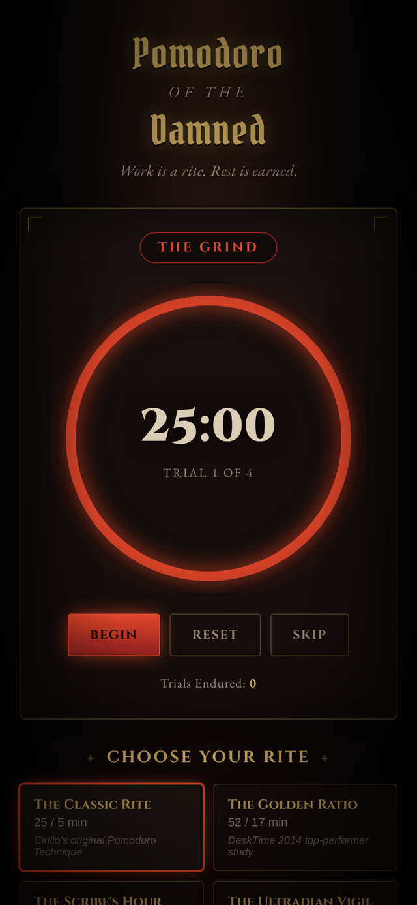

# Pomodoro of the Damned

A grimdark, installable Pomodoro timer. No build step, no dependencies, no backend — pure HTML/CSS/JS, designed to be left open on your phone's screen while you work.

**Live app:** https://imademybones.github.io/Pomodoro/



## Features

- Five researched preset "rites" plus a fully custom timer
- Large, legible countdown with an ember progress ring
- Synthesized bell toll + vibration on phase change (no audio files)
- Screen Wake Lock so the display won't sleep while a trial is running
- Installable PWA (works offline once cached) — add to your phone's home screen
- All state (last preset, custom minutes, sound/wake-lock toggles, trial tally) stays in `localStorage` on your device only
- Theme-aware browser tab favicon — a warmer, higher-contrast variant automatically shows on dark-mode browsers so the icon doesn't vanish into dark tab bars

## The five rites

| Rite | Work / Break | Source |
|---|---|---|
| The Classic Rite | 25 / 5 (long break 15, every 4) | Francesco Cirillo's original Pomodoro Technique |
| The Golden Ratio | 52 / 17 | DeskTime's 2014 study of its most productive users |
| The Scribe's Hour | 50 / 10 (long break 20, every 4) | Common deep-work / long-form writing variant |
| The Ultradian Vigil | 90 / 20 (every 2) | Ultradian-rhythm-based deep work blocks |
| The Novice's Trial | 15 / 5 (long break 10, every 4) | Low-friction starter ratio, popular for building the habit / ADHD-friendly |

Pick "Forge Your Own" for fully custom work/short-break/long-break minutes and how many trials until a long break.

## Installing on your phone

1. Open the live URL above in your mobile browser.
2. **iOS Safari:** Share → *Add to Home Screen*.
3. **Android Chrome:** tap the in-app **Install to Home Screen** button, or use the browser menu → *Install app*.

Once installed it launches full-screen with no browser chrome, and keeps working offline.

## Local development

No build step — just serve the folder statically:

```bash
python3 -m http.server 8080
```

Then open `http://localhost:8080`.

## Deployment

Static site served via GitHub Pages from the `main` branch root. Pushing to `main` redeploys automatically.
